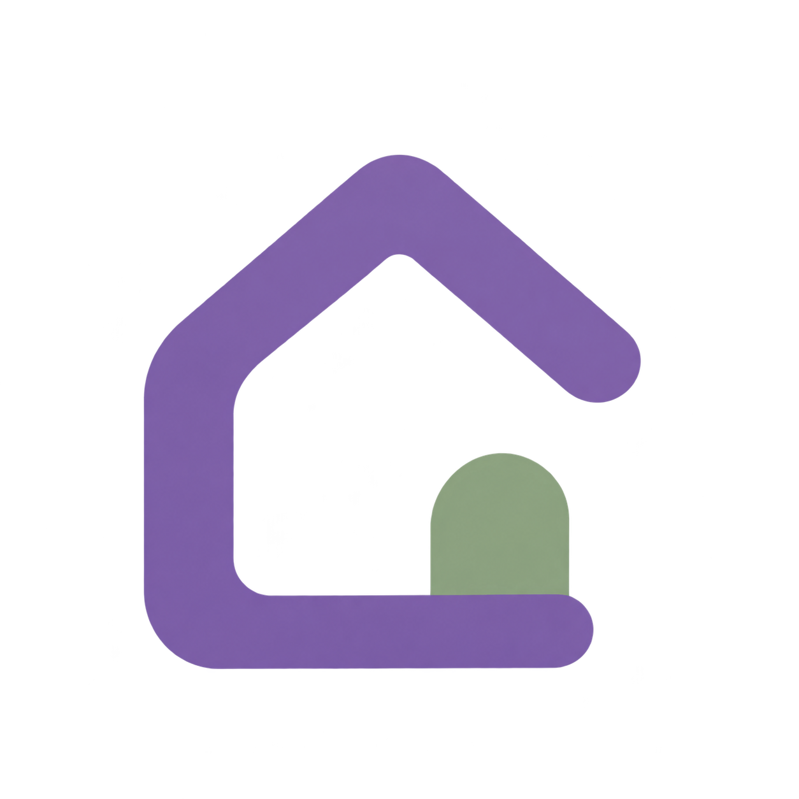

# Soob Corner logo concepts

Generated November 5, 2026 using the built-in image generation tool and the
`imagegen` skill.
The user selected **Study Cottage** as the production logo.
All three PNGs have genuine transparency; source outputs were copied without
altering their pixels or alpha. `public/soob-corner-logo.png` is an exact copy of
the Study Cottage PNG and is used by the app, browser/install metadata and Windows
executable icon. The other two directions remain archived explorations.

The brief is a welcoming house-inspired identity for a TXT fan study app,
with simple silhouettes suitable for developing into small icons and a wordmark.
Korean for house is [집 (jip)](https://krdict.korean.go.kr/eng/dicMarinerSearch/search?mainSearchWord=%EC%A7%91&nation=eng);
the house concept expresses the app's welcoming study-space theme.

| Direction | Idea | Design consideration |
| --- | --- | --- |
| Study Cottage | A rounded home with a warm window and small star | Selected by the user; applied without changing the artwork. |
| Book House | An open book forms the body of a small house | Alternative exploration connecting studying and a welcoming place. |
| Corner Home | An open-sided roof and corner with a small doorway | Simplest silhouette; strongest starting point for a minimal icon. |

The generated images contain some tonal variation despite the flat-color brief.
The selected design retains that appearance and its alpha channel. CSS uses
`object-fit: contain` without a rounded mask. Future refinements should be saved
as separate versions rather than overwriting the selected source artwork.

## Concepts

### Study Cottage


### Book House


### Corner Home



## Generation prompts

Each direction used a separate built-in image-generation call with
`transparent_background: true`. No image references or existing mascots were supplied.

### study-cottage

```text
Use case: logo-brand. Asset: original logo concept for Soob Corner, a cozy TXT fan study and focus app. Generate ONE centered standalone icon on a genuinely transparent background, square composition, ample clear padding. Direction: STUDY COTTAGE. A small friendly house with a softly rounded steep gable roof, short offset chimney, simple rounded door, and one warm golden window suggesting a quiet room to study in. A tiny four-point star near the roof is the only extra accent. Simple distinctive flat geometric silhouette, thick consistent shapes, gently imperfect friendly proportions, polished contemporary indie-app identity. Muted violet main color, soft cream interior, restrained warm golden window. Vector-like crisp edges, solid flat colors, readable at favicon scale. House must be the main visual idea, not real-estate branding. No existing characters, no PPULBATU art, no words, no letters, no mockup, no gradients, no shadows, no landscape, no border or enclosing app tile. Show just one resolved icon, not a sheet of variations.
```

### book-house

```text
Use case: logo-brand. Asset: original logo concept for Soob Corner, a cozy TXT fan study and focus app. Generate ONE centered standalone icon on a genuinely transparent background, square composition, ample clear padding. Direction: BOOK HOUSE. Fuse an open book and a house into one clever compact symbol: a rounded gable roof shelters an open book whose left and right pages form the house body; the center page fold creates a small doorway in negative space. Clearly recognizable as BOTH a home and a book, with very few bold shapes and no tiny drawn page lines. Warm welcoming calm study-nook feeling, polished contemporary indie-app brand. Muted violet roof and main outline, soft cream pages, a restrained dusty sage accent on one lower page. Clean flat graphic, vector-like crisp edges, balanced rounded geometry, strong small-size silhouette. Original design, no existing mascots or logos. No words, no letters, no mockup, no gradients, no shadows, no extra objects, no enclosing tile. One resolved icon only, not a comparison sheet.
```

### corner-home

```text
Use case: logo-brand. Asset: original logo concept for Soob Corner, a calm welcoming TXT fan study app. Generate ONE centered standalone icon on a genuinely transparent background, square composition, ample clear padding. Direction: CORNER HOME. A striking minimal house symbol drawn as one thick rounded geometric ribbon: an asymmetric gable roof flows down the left wall and turns into a lower horizontal corner; the right side is invitingly open, with a small solid rounded doorway tucked inside the lower-right corner. The negative space should feel like a quiet sheltered nook. Much more abstract and minimal than a cute illustrated cottage, but immediately house-related. Muted violet dominant ribbon with a small dusty sage doorway/accent, only two solid colors. Softened joins and generous negative space, professional distinctive contemporary app mark, legible at 24px. Flat vector-like edges, no texture. No lettering, no words, no brand initials, no existing mascot, no mockup, no gradients, no shadows, no tile or border, no additional objects. One resolved symbol, no grid or variations.
```
