# Screenshots and feature walkthrough

Screenshot assets live in `docs/images/`. New captures should use an isolated
demo profile with example tasks, so personal study data does not appear in
documentation. Capture the running app, including real playback when available.

## Main features to demonstrate

1. **Video discovery:** search, member chips, type/date filters, and thumbnails.
2. **Focus timer:** video playback beside the timer and expanded session settings.
3. **Tasks:** a populated checklist with unfinished and completed work.
4. **Profile:** XP, next-level progress, lifetime hours, and milestones.
5. **Appearance:** palette choices and the frosted-to-solid opacity control.

## Current dark-mode screenshots

### Interface languages — November 3, 2026

Settings offers English, Simplified Chinese, Korean, Spanish and Japanese. These isolated
demo captures show Chinese/Japanese settings and Spanish/Japanese timers at a 375px viewport.
The timer crop excludes a simulated background player; it does not verify live
media. Language changes preserve the current study session and saved user text.

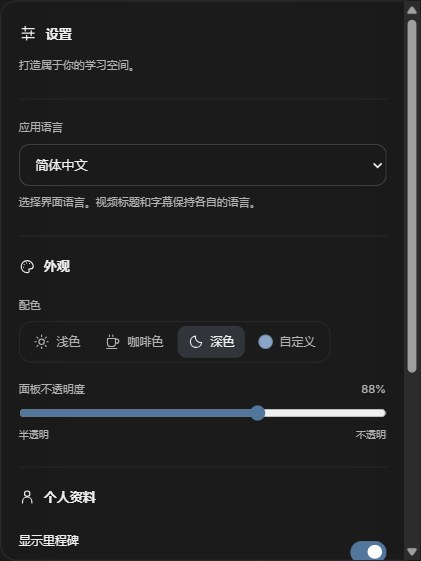

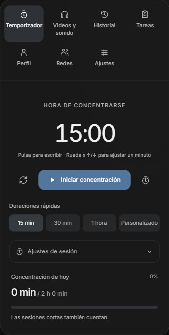

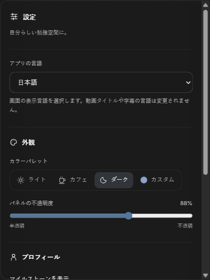

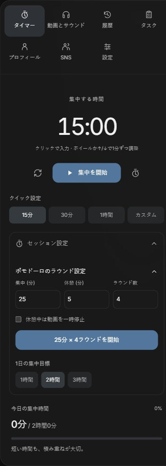

### English-preferred video labels — November 3, 2026

This real catalog entry uses YouTube's English watch-page title. Its Korean
original remains searchable and available in the card tooltip. Titles without
an English version remain in their original language. The capture uses an
isolated browser profile and does not imply that playback was verified.

### Mobile timer and welcome controls — November 3, 2026

The narrow-screen dock grows with its content so Start and quick durations use
normal page scrolling. This crop shows the full dock at a 375px viewport with a
15-minute preset. The welcome screen keeps Start/Pause available before choosing
a video and after returning from one. Both captures use an isolated demo profile;
the background player was mocked and is outside these crops.

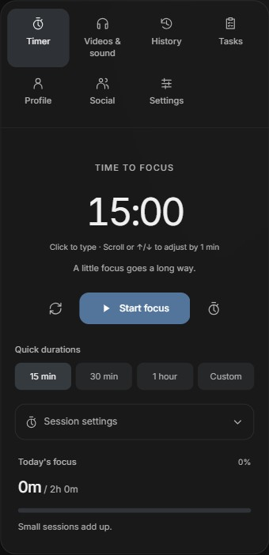

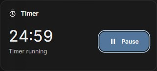

### Video queue — November 3, 2026

The start screen's **Up next** list saves your selected videos in order. Use
the arrows to reorder, remove individual entries, or **Play queue** to begin.
The same queue is available in the **Videos & sound** tab during study sessions.
This capture uses an isolated browser profile with three catalog videos queued.

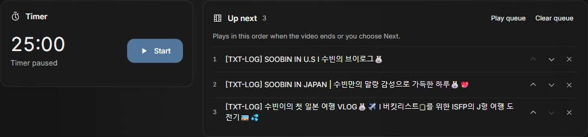

### Watch history and viewing stats — November 3, 2026

The welcome screen's **Watch history** tab opens a dedicated full-page list, with
**Videos** alongside it for returning to discovery. This capture uses four real
catalog entries in an isolated demo history; it does not depict personal data.

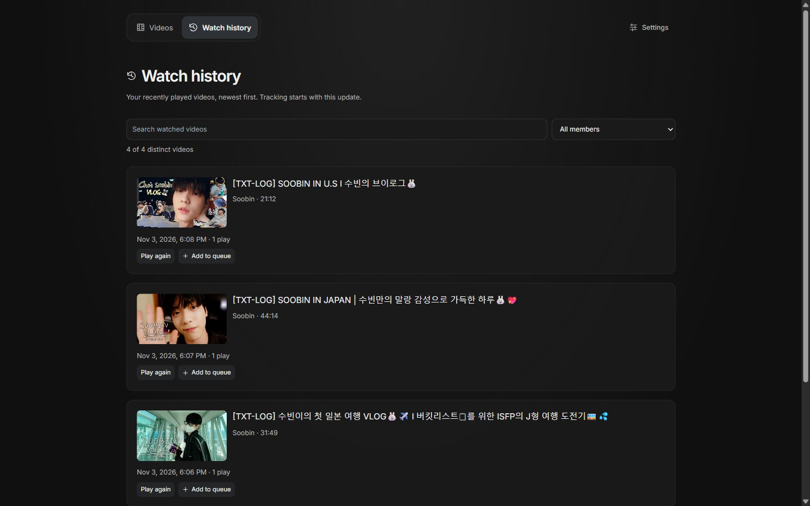

History shows recent videos, member/search filters, replay and queue actions.
Profile separates distinct videos from total plays and counts shared videos for
each featured member. These captures use an isolated demo profile with three
videos and two rewatches; player events were simulated for repeatable checks.

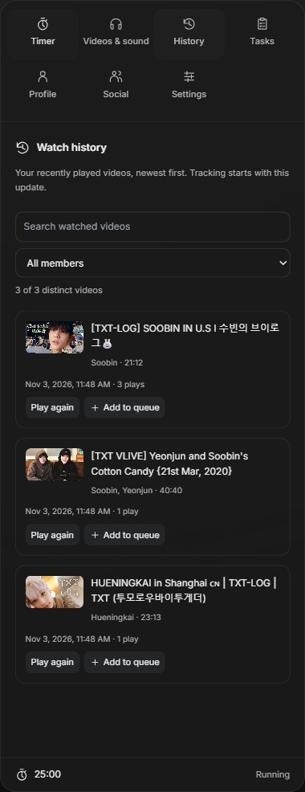

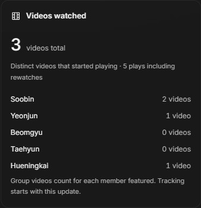

### Timer controls — November 3, 2026

Quick durations remain visible with Session settings closed. The countdown hints
at click-to-type and mouse-wheel adjustment. This isolated demo profile uses a
30-minute duration and the Dark theme.

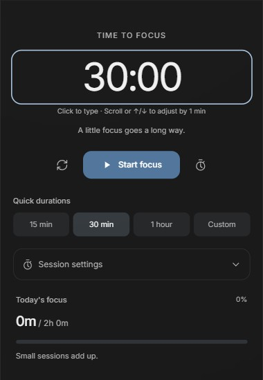

### Keyboard access — November 3, 2026

Settings provides keyboard help and a saved shortcut switch. The Timer capture
also demonstrates the visible keyboard focus outline on the countdown.

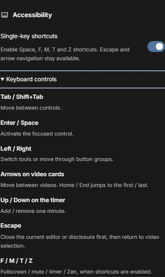

### Settings — November 3, 2026

The Settings tools tab groups palettes, panel opacity, and optional milestone
cards. The same settings are accessible before choosing a video. This capture
uses an isolated demo profile; the running timer remains available in the footer.

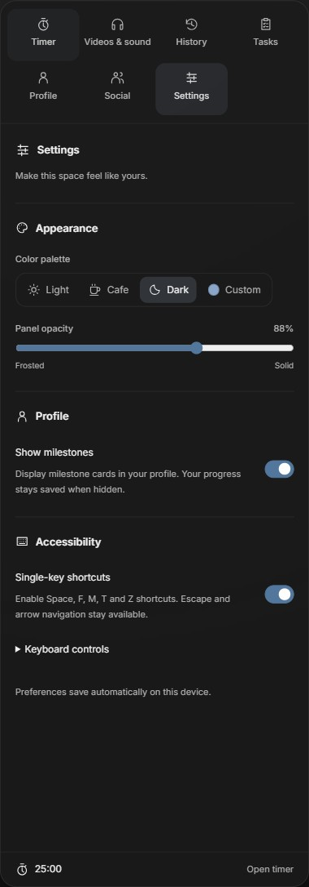

### October workspace captures

Captured October 18, 2026 from the Windows app with the neutral charcoal Dark
preset and an isolated demo profile. The workspace uses actual YouTube playback,
paused for consistent captures. The example tasks and progress are demo data.
Profile settings and progression are available only in the **Profile** tools tab;
the home screen and toolbar keep their focus on choosing and studying with a video.

### Video discovery

Search, member and video-type filters share the dark palette.

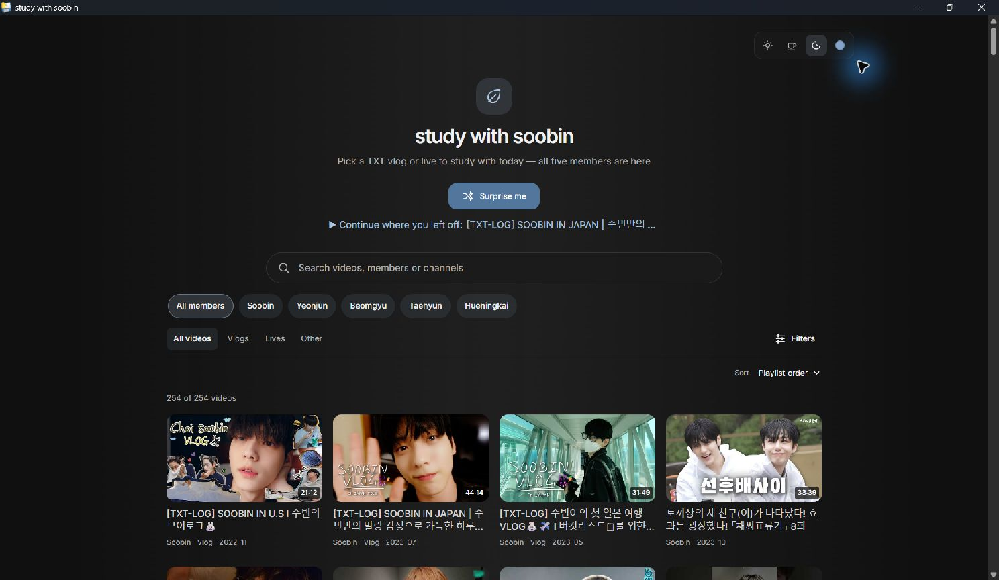

### Study workspace

The timer and playback controls sit beside and below the reserved video stage.

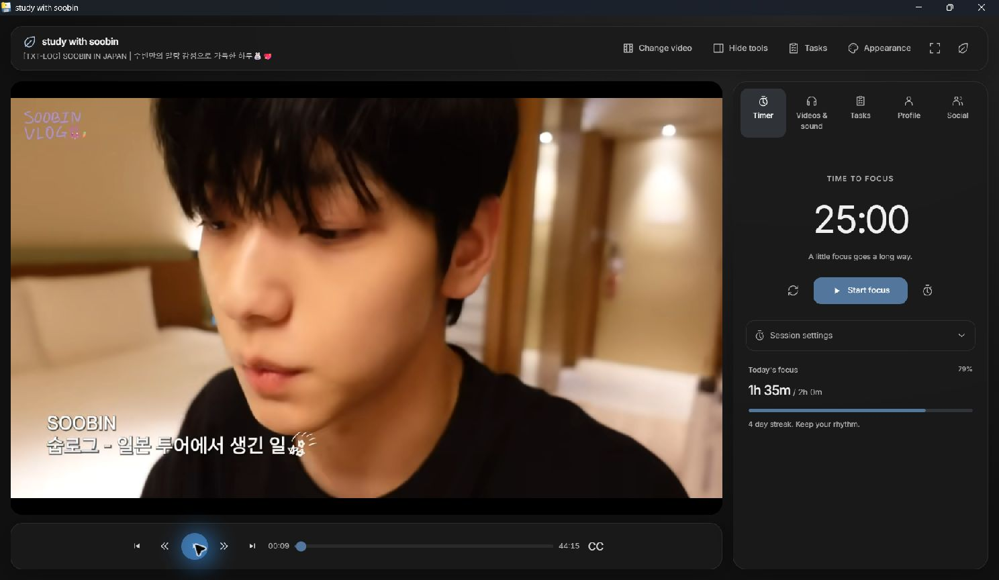

### Tasks

The checklist shows priorities, estimates, progress, and the loaded focus task.
[Completed work](images/dark-completed-tasks.jpg) remains available in its disclosure.

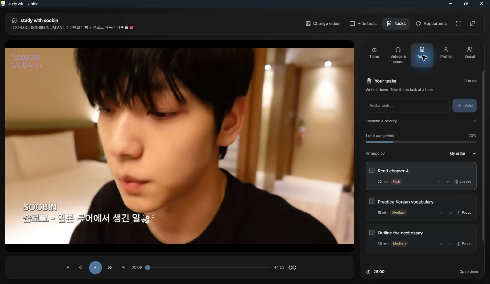

### Profile and study hours

The demo profile shows Level 5, XP toward the next level, and 12 hours 35 minutes
studied. [Study hours and milestones](images/dark-study-hours.jpg) share the same
neutral surfaces and readable text.

Open **Edit profile** within the tab to change the display name and avatar.

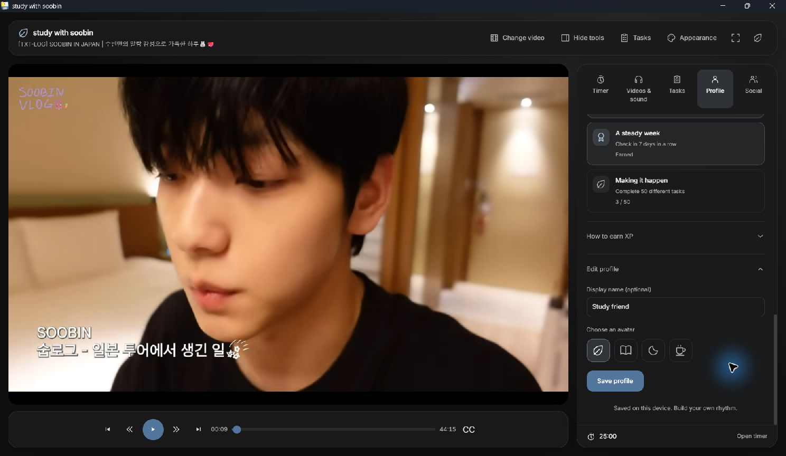

### Appearance

The renamed Dark preset and saved panel-opacity control appear inline.

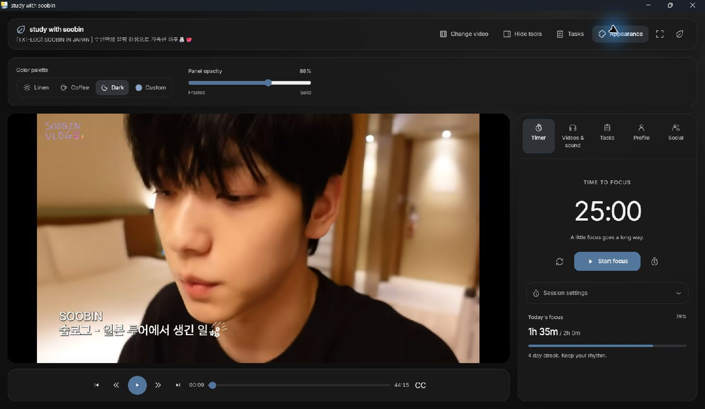

### Social

Group and member account links appear in the Social tab.

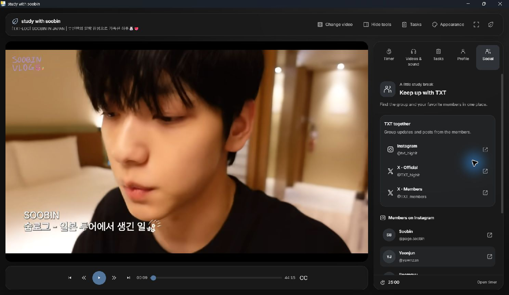

## Earlier reference images

These images predate the current appearance and profile features. They are kept
as historical references, rather than presented as screenshots of the new UI.

### Video catalog

### Study workspace

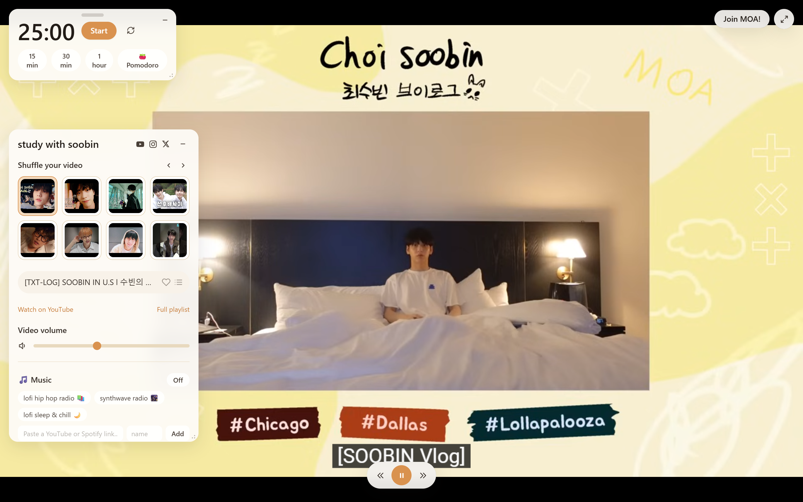
