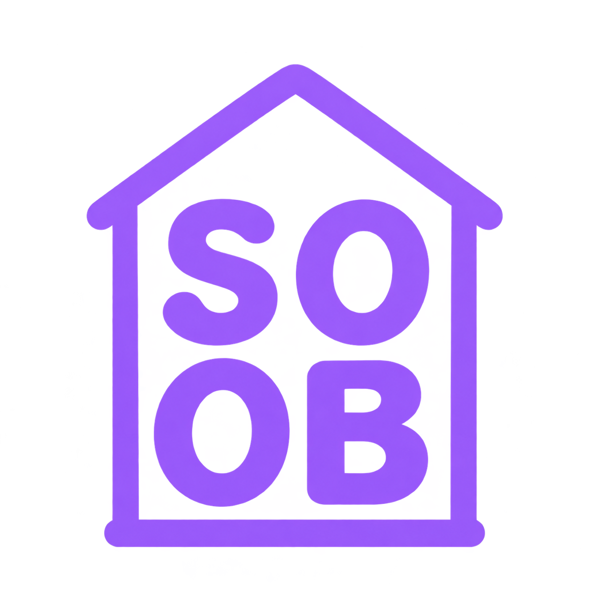

## Minimal SOOB house — two-by-two grid

The revised brief places **S O** in the first row and **O B** in the second,
centered inside a simple purple house outline. The user subsequently supplied a
revised icon, now used as `public/soob-house-logo.png`. That exact selected image
has a white background; the generated transparent prototype below is archived.
The prototype letters were visually checked
and the transparency was verified in browser previews on light and dark surfaces.
The original output was copied without changing its pixels or alpha.



Saved file: `docs/images/logo-concepts/soob-house-grid.png`, 1254 × 1254px RGBA.
Generated with the built-in image tool. The earlier portfolio HOME wordmark was
a style reference for the intermediate one-line logo; that intermediate was then
edited into the requested grid.

### Initial house prompt

```text
Use case: logo-brand. Generate one new logo for Soob Corner, on a genuinely transparent background.
Reference image 1 is STYLE REFERENCE ONLY: borrow its lavender purple color and friendly rounded lettering, but replace the existing HOME wordmark with the new design below.
Primary design: a minimal house outline surrounding the exact uppercase word "SOOB", spelled S O O B. The word SOOB must be centered INSIDE the house in ONE horizontal line, large and very legible. A simple gently pitched gable roof, two short walls and a clean base make the house silhouette. Use consistent substantial rounded strokes and generous clear spacing around the text. The four letters should have the soft rounded, slightly playful typographic feel of the reference, with enough weight for a small app logo.
Use ONLY one solid lavender-purple color close to #A577FF; transparent negative space everywhere else, including inside the house and inside letter counters. Clean flat vector-like graphic, no shading or texture. Compact balanced square composition with about 12% transparent padding. Friendly understated indie study-app identity, not a real estate logo.
No stars, no chimney, no windows, no door, no book, no cottage illustration, no gradients, no highlights, no shadows, no enclosing tile, no 3D. No text except the exact four letters SOOB. Do not retain HOME. Show ONE resolved logo only, not a variation board.
```

### Grid edit prompt

```text
Edit the supplied minimal purple SOOB house logo. Change the lettering layout into a clearly aligned TWO BY TWO GRID inside the house:
TOP ROW: S O
BOTTOM ROW: O B
Read left-to-right across the top and then bottom: S O O B. Exactly four uppercase letters, no other text. Each letter occupies one cell of the 2x2 arrangement. Both O letters must be visible and separate. Use equal optical letter sizes, generous consistent row and column spacing, and center the complete grid inside the walls.
Preserve the simple rounded lavender-purple house outline and the single-color identity. Adjust the house body to be taller and compact/square enough to comfortably contain the two rows, with a simple gable roof above. Keep letter strokes substantial, softly rounded, and friendly, similar to the earlier HOME 2x2 typographic logo. Use only solid lavender purple close to #A577FF; everything else is true transparent negative space, including the inside of the house and letter counters. Clean crisp flat logo, no texture, no shading, no gradient or glow, no stray colored pixels or speckles. About 12% clear margin around the complete logo. No window, no door, no chimney, no star, no illustrations, no enclosing app tile. One centered resolved logo only. Transparent PNG background.
```
